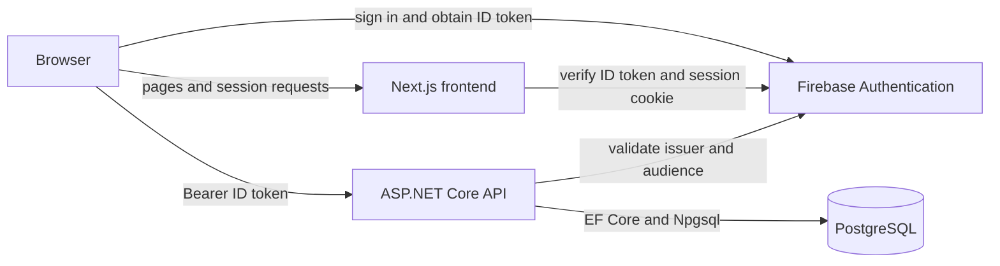
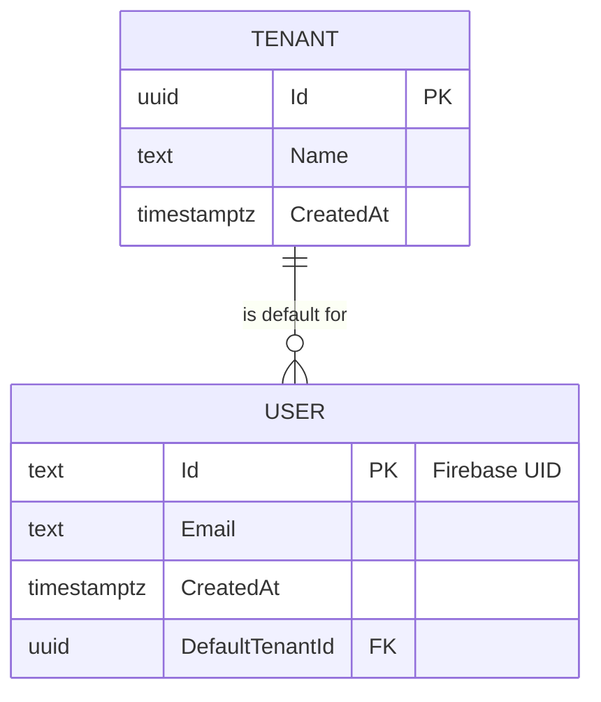
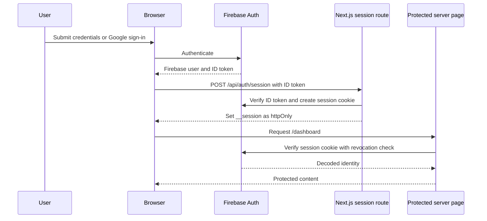
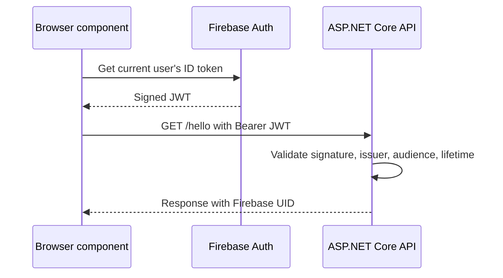

# Finapp System Architecture

> Technical reference for the implemented system. See
> [`INFRASTRUCTURE.md`](INFRASTRUCTURE.md) for runtime and deployment concerns,
> and [`CODEBASE-GUIDE.md`](CODEBASE-GUIDE.md) for repository orientation.

## 1. Current scope

Finapp is a web application with separate frontend and backend runtimes. The
frontend owns the user interface and browser session. The backend owns the
relational domain model and authenticated application endpoints. Firebase is
the shared identity provider.

The current implementation proves authentication across both runtimes:

1. A user signs in with email and password or Google.
2. Next.js creates and verifies its own secure session cookie.
3. The browser can obtain a Firebase ID token and call the protected backend.
4. The backend validates the token and exposes the authenticated Firebase UID.

The finance domain is not implemented beyond the initial `Tenant` and `User`
entities.

## 2. Technology stack

| Area | Technology |
|---|---|
| Frontend runtime | Next.js 16.3.6 App Router, React 19.2.8, TypeScript 5 |
| Frontend styling | Tailwind CSS 4 |
| Browser identity | Firebase Web SDK 12 |
| Server session | Firebase Admin SDK 14 and an httpOnly cookie |
| Backend runtime | ASP.NET Core Minimal API on .NET 10 |
| Backend identity | JWT Bearer authentication for Firebase ID tokens |
| Persistence | PostgreSQL 18 locally, EF Core 10, Npgsql |
| Local orchestration | Docker Compose for PostgreSQL only |
| Validation | GitHub Actions on Ubuntu, Node.js 24, and .NET 10 |

## 3. Runtime modules

### 3.1 Frontend module

The frontend lives in `finapp/frontend` and has three important seams:

| Seam | Interface | Implementation |
|---|---|---|
| Browser authentication | `firebaseAuth()` and `googleProvider()` | Firebase Web SDK in `lib/firebase/client.ts` |
| Server authentication | `createSession()`, `getCurrentUser()`, `clearSession()` | Firebase Admin SDK plus Next.js cookies in `lib/auth/session.ts` |
| Backend access | HTTP request with `Authorization: Bearer <id-token>` | Client components such as `app/dashboard/call-api-button.tsx` |

Routes currently implemented:

| Route | Runtime | Responsibility |
|---|---|---|
| `/` | Next.js server | Redirect to `/dashboard` or `/login` from verified session state |
| `/login` | Server shell and client form | Register or sign in with Firebase |
| `/dashboard` | Next.js server | Verify the session and render the protected page |
| `POST /api/auth/session` | Next.js route handler | Exchange a Firebase ID token for a session cookie |
| `DELETE /api/auth/session` | Next.js route handler | Revoke refresh tokens and clear the cookie |

`AuthProvider` mirrors browser authentication state for client components. It
does not authorize server-rendered content.

### 3.2 Backend module

The backend lives in `finapp/backend`. `Program.cs` currently contains the
composition root, middleware pipeline, authentication configuration, and HTTP
endpoints.

| Endpoint | Authorization | Responsibility |
|---|---|---|
| `GET /health` | Anonymous | Return a simple process health response |
| `GET /hello` | Firebase Bearer token | Return a connectivity response and authenticated UID |
| `/openapi/v1.json` | Development only | Expose generated OpenAPI metadata |

Authentication validates the Firebase project as both issuer namespace and
audience. Endpoint code reads the Firebase UID from the name identifier claim.

### 3.3 Persistence module

`AppDbContext` is the persistence interface used by the backend. The initial
migration creates:

The relationship is required and cascades when a Tenant is deleted. A Tenant
can be referenced as the default by many users, but there is no explicit Tenant
membership entity and no application flow currently creates or queries these
records.

## 4. Authentication flows

### 4.1 Browser to Next.js session

The cookie lifetime is five days. It uses `httpOnly`, `sameSite=lax`, root path,
and `secure` in production. `proxy.ts` only performs an optimistic redirect
based on cookie presence. `getCurrentUser()` is the authorization check.

### 4.2 Browser to backend API

These are separate credentials. The Next.js cookie is not forwarded to the
backend, and the backend does not validate the Next.js session cookie.

## 5. Configuration interfaces

### Frontend browser variables

The six `NEXT_PUBLIC_FIREBASE_*` values configure the Firebase Web SDK.
`NEXT_PUBLIC_API_BASE_URL` selects the backend origin. Values prefixed with
`NEXT_PUBLIC_` are visible to the browser and must not contain secrets.

### Frontend server variables

`FIREBASE_PROJECT_ID`, `FIREBASE_CLIENT_EMAIL`, and `FIREBASE_PRIVATE_KEY`
configure Firebase Admin. The private key is a secret and supports literal
`\n` sequences in environment files.

### Backend configuration

`Firebase:ProjectId` configures JWT validation and
`ConnectionStrings:PostgreSQL` configures EF Core. Development settings contain
placeholder connection data, so local execution requires an override through
user secrets, environment variables, or an uncommitted settings file.

## 6. Architectural constraints

- Identity starts with the Firebase UID. Domain authorization must map that UID
  to a persisted User and an ownership scope before reading or changing data.
- `Tenant` is the likely aggregate for shared financial data, but the current
  model only gives each User one required `DefaultTenantId`. Multi-tenant
  membership and invitations do not exist.
- The frontend and backend have separate authentication adapters. New backend
  calls should continue to use Firebase ID tokens unless the authentication
  contract is deliberately redesigned.
- The backend currently has a permissive CORS policy. A production design must
  allow only known frontend origins.
- There is no application module for Accounts yet. Account CRUD should expose a
  small authenticated HTTP interface and keep ownership checks, validation, and
  EF Core persistence local to that module.

## 7. Planned Account module decisions

Issue 3 targets multiple accounts per user. Before implementation, settle these
model decisions in the issue or an architecture decision record:

| Decision | Current evidence | Required outcome |
|---|---|---|
| Ownership | User points to a default Tenant | Choose User-owned or Tenant-owned accounts |
| Tenant access | No membership model | Define how a UID gains access to a Tenant |
| Money representation | No monetary types | Choose currency representation and decimal precision |
| Deletion | No domain deletion policy | Choose hard delete, archive, or soft delete |
| Account uniqueness | No Account entity | Define name uniqueness within the ownership scope |

The preferred module seam is an authenticated `/accounts` route group backed
by domain operations that accept the validated UID. The implementation should
resolve ownership internally rather than exposing tenant or user authorization
rules to every caller.

## 8. Known gaps

- No account, transaction, category, budget, or balance features.
- No endpoint that provisions a database User or Tenant after registration.
- No automated frontend tests and no backend test project.
- No role or permission model.
- No production observability, rate limiting, or error contract.
- No production deployment definition in source control.
