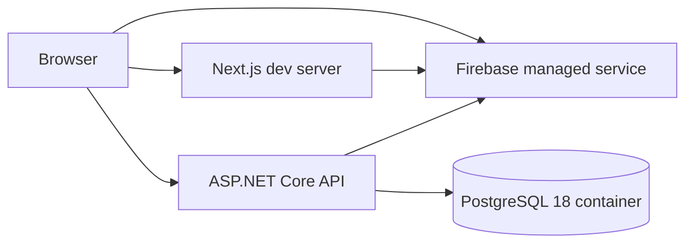

# Finapp Infrastructure and Deployment

> Runtime, configuration, validation, and deployment reference. This document
> describes what is present in source control and labels missing production
> infrastructure explicitly. See [`ARCHITECTURE.md`](ARCHITECTURE.md) for
> application design.

## 1. Current infrastructure status

The repository defines local PostgreSQL and continuous integration. It does not
define production hosting, infrastructure as code, container images for the
applications, release workflows, DNS, TLS, secrets management, backups, or
observability.

| Concern | Current state |
|---|---|
| Local database | PostgreSQL 18 through `finapp/docker-compose.yml` |
| Frontend runtime | Run directly with Node.js and Next.js |
| Backend runtime | Run directly with the .NET SDK |
| CI | Separate GitHub Actions workflows for frontend and backend |
| Deployment | Not defined |
| Production environments | Not defined |
| Secrets store | Not defined |
| Monitoring and logs | Framework console logging only |

## 2. Local topology



Docker Compose starts only the database:

```powershell
Set-Location finapp
docker compose up -d db
```

The Compose service publishes `${POSTGRES_PORT}` on the host to PostgreSQL port
5432 and requires `POSTGRES_USER`, `POSTGRES_PASSWORD`, and `POSTGRES_DB`.

The applications are started separately:

```powershell
# Terminal 1
Set-Location finapp/frontend
npm ci
npm run dev

# Terminal 2
Set-Location finapp/backend
dotnet restore
dotnet run
```

The backend launch profiles use `http://localhost:5266` and
`https://localhost:7280`. The committed frontend example points
`NEXT_PUBLIC_API_BASE_URL` at `https://localhost:5001`, so local developers
must align that variable with the selected backend profile.

## 3. Configuration inventory

### 3.1 PostgreSQL container

| Variable | Consumer | Secret |
|---|---|---|
| `POSTGRES_USER` | Docker Compose | No |
| `POSTGRES_PASSWORD` | Docker Compose | Yes |
| `POSTGRES_DB` | Docker Compose | No |
| `POSTGRES_PORT` | Docker Compose | No |

### 3.2 Frontend

| Variable | Consumer | Secret |
|---|---|---|
| `NEXT_PUBLIC_FIREBASE_API_KEY` | Firebase browser SDK | No |
| `NEXT_PUBLIC_FIREBASE_AUTH_DOMAIN` | Firebase browser SDK | No |
| `NEXT_PUBLIC_FIREBASE_PROJECT_ID` | Firebase browser SDK | No |
| `NEXT_PUBLIC_FIREBASE_STORAGE_BUCKET` | Firebase browser SDK | No |
| `NEXT_PUBLIC_FIREBASE_MESSAGING_SENDER_ID` | Firebase browser SDK | No |
| `NEXT_PUBLIC_FIREBASE_APP_ID` | Firebase browser SDK | No |
| `NEXT_PUBLIC_API_BASE_URL` | Browser backend calls | No |
| `FIREBASE_PROJECT_ID` | Firebase Admin SDK | No |
| `FIREBASE_CLIENT_EMAIL` | Firebase Admin SDK | Sensitive identifier |
| `FIREBASE_PRIVATE_KEY` | Firebase Admin SDK | Yes |

Use `finapp/frontend/.env.example` as the shape of local configuration. Real
credentials belong in `.env.local` or an external secret store and must not be
committed.

### 3.3 Backend

ASP.NET Core configuration keys can come from settings files, environment
variables, user secrets, or a future deployment provider.

| Key | Environment form | Secret |
|---|---|---|
| `Firebase:ProjectId` | `Firebase__ProjectId` | No |
| `ConnectionStrings:PostgreSQL` | `ConnectionStrings__PostgreSQL` | Yes |

The committed connection strings are placeholders. A usable local connection
string must match the Compose database credentials and published port.

## 4. Database lifecycle

EF Core migrations live in `finapp/backend/Migrations`. The initial migration
creates `Tenants` and `Users`.

Apply migrations from the backend directory after PostgreSQL is available:

```powershell
dotnet ef database update
```

The repository includes the EF Core design package but does not define an
automatic migration step. Production deployment must choose one owner for
migrations, such as a release job or a dedicated migration process. Multiple
application replicas should not independently race to apply schema changes.

## 5. Continuous integration

Both workflows run for pushes and pull requests targeting `main` or `develop`,
limited to their application path. The backend workflow also includes
`finapp/backend.tests/**`.

### Frontend workflow

`.github/workflows/frontend.yml` uses Ubuntu and Node.js 24 with npm caching:

1. Check out the repository.
2. Run `npm ci`.
3. Run `npm run test:run` for unit and component tests.
4. Run `npm run build`, then `npx tsc --noEmit` using generated Next.js types.
5. Run `npm run lint` before browser tests create isolated generated output.
6. Install Playwright Chromium with its system dependencies.
7. Run `npm run test:e2e` in the default demo environment.
8. Run only `e2e/finance-api.spec.ts` with data source `api` and
   `NEXT_PUBLIC_API_BASE_URL=https://api.e2e.test`. The API is intercepted by
   Playwright; port 3101 and `.next-e2e-api` isolate its server and build from demo.

### Backend workflow

`.github/workflows/backend.yml` uses Ubuntu and .NET 10 with NuGet caching:

1. Check out the repository.
2. Cache NuGet packages using the lockfiles and project files from both
   `finapp/backend` and `finapp/backend.tests`.
3. Run `dotnet restore ../backend.tests/Finapp.Api.Tests.csproj --locked-mode`
   from `finapp/backend`. The test project references the API project.
4. Build that test project in Release with `--no-restore`.
5. Run `dotnet test` on that test project in Release with `--no-build`.

Cache behavior and the complete Ubuntu jobs still require a GitHub Actions run.

## 6. Production deployment contract

A future deployment design needs to supply these runtime capabilities:

| Capability | Frontend | Backend | Database |
|---|---|---|---|
| Runtime | Node.js compatible Next.js host | .NET 10 compatible host | Managed PostgreSQL or operated PostgreSQL |
| Public routing | HTTPS web origin | HTTPS API origin | Private connectivity preferred |
| Configuration | Browser Firebase config and server credentials | Firebase project ID and connection string | User, password, database, network rules |
| Health check | Add a deployment-specific page or route | `GET /health` | Provider health and connection checks |
| Scaling | Support server-rendered routes and route handlers | Stateless HTTP replicas | Connection limits and pooling |
| Secrets | Server-side secret injection | Server-side secret injection | Credential rotation |

The frontend needs Firebase Admin credentials at request time, so it cannot be
deployed as a purely static site. The backend is stateless apart from PostgreSQL
and can scale horizontally once database connection limits are handled.

## 7. Security and operations checklist

Before a production release:

- Restrict backend CORS to known frontend origins.
- Store Firebase Admin credentials and the PostgreSQL connection string in a
  managed secret store.
- Define separate development, staging, and production configuration.
- Decide where EF Core migrations run and how rollback is handled.
- Add database backups, restore testing, encryption, and retention policies.
- Add structured logs, request correlation, metrics, and alerting.
- Add backend rate limiting and a stable error response contract.
- Configure Firebase authorized domains and provider settings per environment.
- Verify HTTPS redirects behind the selected reverse proxy.
- Add dependency and container vulnerability scanning when deployment artifacts
  exist.

## 8. Maintenance

Update this document when Docker Compose, configuration keys, workflow triggers,
hosting, environments, deployment steps, migration ownership, or operational
controls change. Keep proposed infrastructure clearly separated from resources
that the repository actually provisions.
